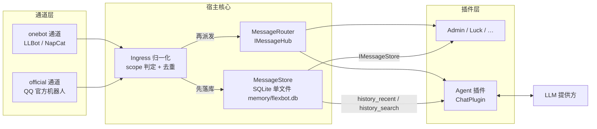
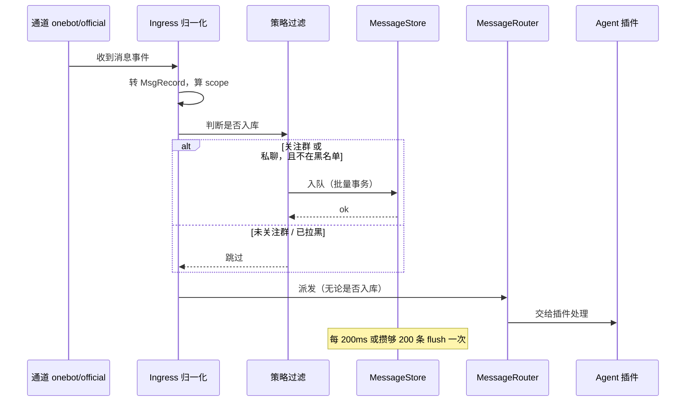
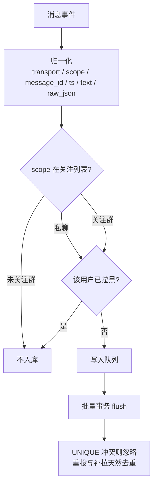
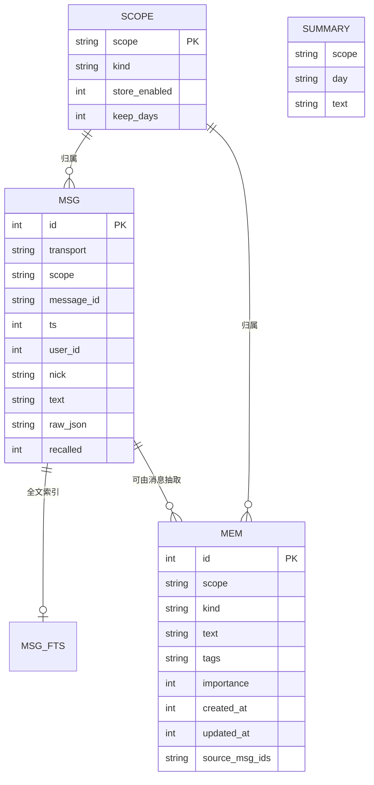
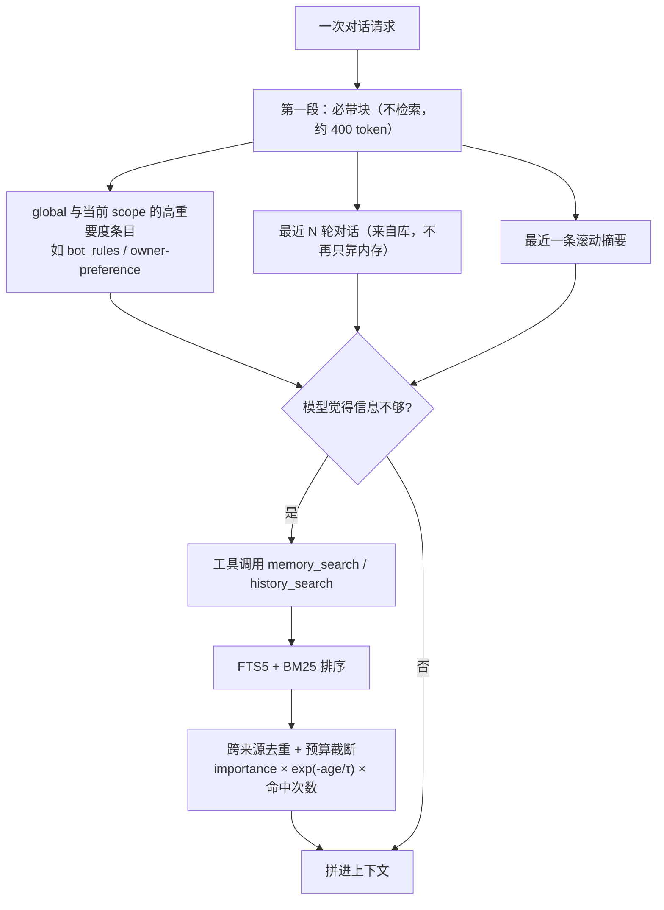
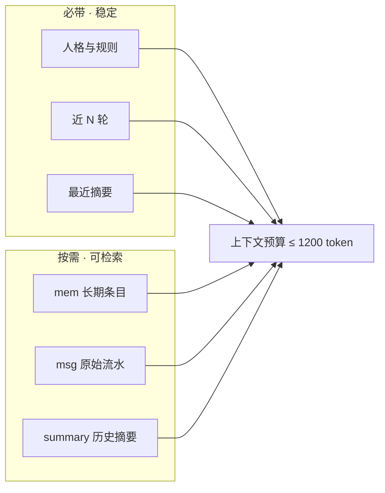
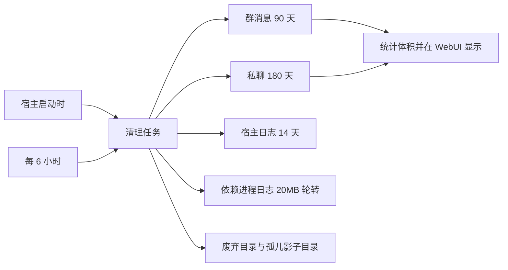
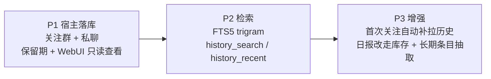
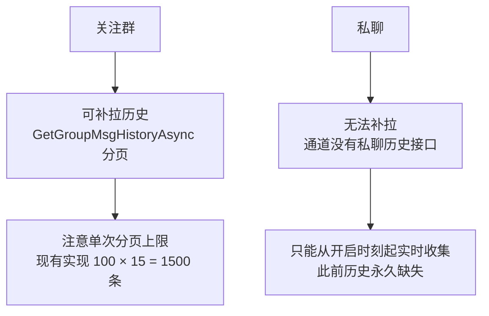

# 记忆与聊天记录：存储与读取设计

> 目标：让 Agent 能**记得住**、**查得到**；范围只覆盖**关注群**与**私聊**，不做全量收集。
> 本文所有"现状"结论都来自实际代码与实测数据（见文末「依据」）。

## 1. 目标与边界

| 要解决 | 不要做 |
|---|---|
| 会话历史重启即失（现在只在内存里） | 全量收集所有群（隐私 + 磁盘） |
| 长期摘要只注入"最近一段"，早先内容永不出现 | 把全部历史塞进 prompt |
| 结构化记忆写了却没人读（模型得猜文件名） | 每条消息同步落盘 |
| "上周谁说过 X" 答不了 | 引入外部数据库/服务（SQLite 单文件足够） |

## 2. 总体架构



要点：**存储挂在派发之前**。插件抛异常、短路、不回复，都不影响记录；存储也不依赖任何插件是否加载。

## 3. 写入路径





## 4. 存储模型



```sql
-- 原始流水（关注群 + 私聊）
CREATE TABLE msg(
  id INTEGER PRIMARY KEY,
  transport TEXT,        -- onebot | official
  scope     TEXT,        -- group:748394300 | private:2794805076
  message_id TEXT,
  ts INTEGER,            -- 秒
  user_id INTEGER, nick TEXT,
  text TEXT,             -- 纯文本化：@昵称、图片→[图片]
  raw_json TEXT,         -- 原样存档，以后加字段不必重新采集
  recalled INTEGER DEFAULT 0,
  UNIQUE(transport, scope, message_id, ts)   -- 特意带上 ts：onebot 的 message_id 是 int32，机器人重启后可能重复
);
CREATE INDEX idx_msg_scope_ts ON msg(scope, ts);

-- 中文检索：默认 unicode61 不切中文，必须用 trigram
CREATE VIRTUAL TABLE msg_fts USING fts5(text, content='msg', content_rowid='id', tokenize='trigram');

-- 长期记忆条目（替代散落的 md）
CREATE TABLE mem(
  id INTEGER PRIMARY KEY,
  scope TEXT, kind TEXT,   -- kind: rule | preference | fact | event | relation
  text TEXT, tags TEXT,
  importance INTEGER, created_at INTEGER, updated_at INTEGER,
  source_msg_ids TEXT
);

-- 滚动摘要
CREATE TABLE summary(scope TEXT, day TEXT, text TEXT, PRIMARY KEY(scope, day));
```

人类可读性：`mem` 变更时**单向导出**到 `memory/export/<scope>/*.md`（只写不读），你仍能直接看和手改。

## 5. 读取路径（两段式）





Agent 获得四个工具：`history_search` / `history_recent` / `memory_write` / `memory_forget`。

## 6. 保留期与清理



保留期可从 WebUI 调整；清理沿用已经落地的 `LogHousekeeping` 模式（启动一次 + 周期一次）。

## 7. 隐私与隔离

| scope | 含义 | 检索可见性 |
|---|---|---|
| `global` | 全局规则与偏好 | 任何对话可见 |
| `group:<id>` | 该群的消息与条目 | **仅该群**可见 |
| `user:<uin>` | 该用户私聊的消息与条目 | **仅该私聊**可见 |

规则：检索**强制** scope 过滤，群记忆绝不进入私聊或别的群；`store_enabled=0` 的 scope 完全不写；凭证类内容（cookie、token、密钥）永不入库；`raw_json` 只存消息本体。

## 8. 分阶段落地



- **P1（半天左右）**：宿主 `MessageStore` + 策略过滤 + 批量写入 + 保留期；WebUI 只读页（条数 / 体积 / 最近消息）
- **P2**：`msg_fts` + 两个检索工具 + 必带注入改为从库取近 N 轮（同时修掉"超限就丢"的毛病）
- **P3**：首次关注群调用 `GetGroupMsgHistoryAsync` 分页补拉；`SummarizeDayAsync` 改为查库；按天总结顺带产出结构化 `mem` 条目（复用同一次模型调用，零额外成本）

## 9. 能力边界（必须知道的硬约束）



## 10. 依据（实测）

- 会话历史目前是 `_convHist` **纯内存**，超 `MaxContextTurns*2` 直接丢最旧一轮，**无补偿**
- 长期摘要 `GetMemSummary` 只取 `Split("## ").LastOrDefault()` ⇒ **只有最近一段**进 prompt
- 结构化记忆已存在（`memory/group_748394300/*.md` 等实测 6 个文件），但 Agent 侧**没有任何枚举/注入**代码，只有 `fs_list` 工具 ⇒ 写了没人读
- 全仓**无任何消息持久化实现**；`IBotApi` 只有群历史接口，**无私聊历史接口**
- 体积估算：纯文本 ~200B/条；1 万条/天 ≈ 2MB/天 ⇒ 群 90 天 ≈ 180MB（对照：本轮磁盘卫生刚从 410MB 压到 79MB，保留期必须一开始就定）
- 写入绝不能每条 fsync：本轮已在日志管线中确认 `AutoFlush=true` 逐行同步写盘的代价

## 11. 明确不做

全量收集所有群；按天分目录存 JSONL 再靠 grep 检索；每条消息同步落盘；把私聊内容送远端做 embedding；为存储引入外部数据库服务。
